<!--
  Every panel below is a hand-built SVG rendered by scripts/render.py.
  .github/workflows/telemetry.yml rebuilds them daily from live GitHub data.
  To change text, projects or stack, edit the CONTENT section of scripts/render.py.
-->

<a href="https://vaibhavchaubey.live"></a>



  <a href="https://github.com/vaibhav449/Retently"></a>
  <a href="https://github.com/vaibhav449/autoapply"></a>

  <a href="https://github.com/vaibhav449/incident-triage-copilot"></a>
  <a href="https://github.com/vaibhav449/HealthShield"></a>

  <a href="https://github.com/vaibhav449/HireScope"></a>
  <a href="https://github.com/vaibhav449/basic_chat"></a>


<a href="https://vaibhavchaubey.live"></a>

